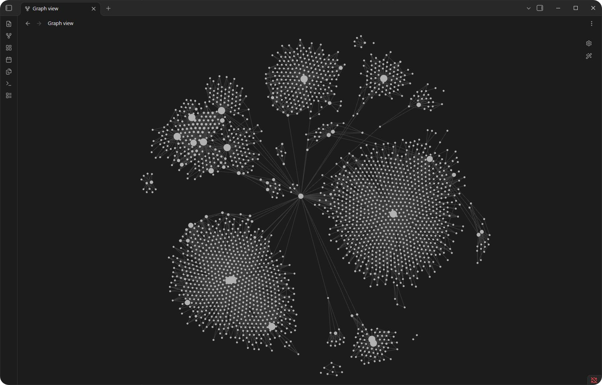
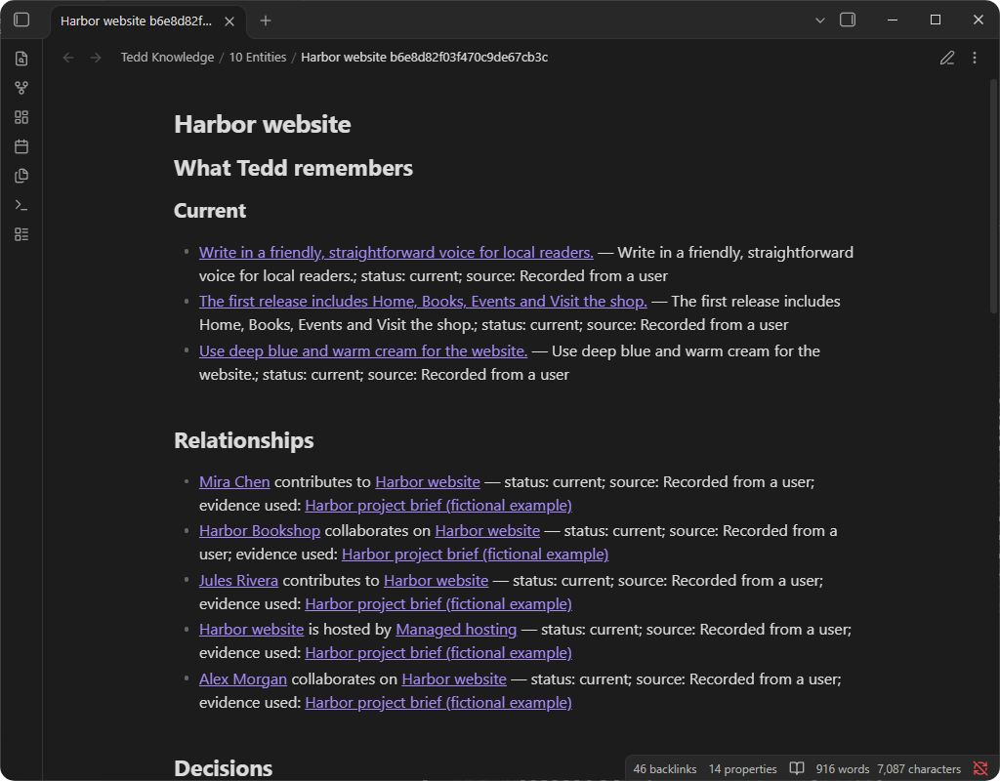
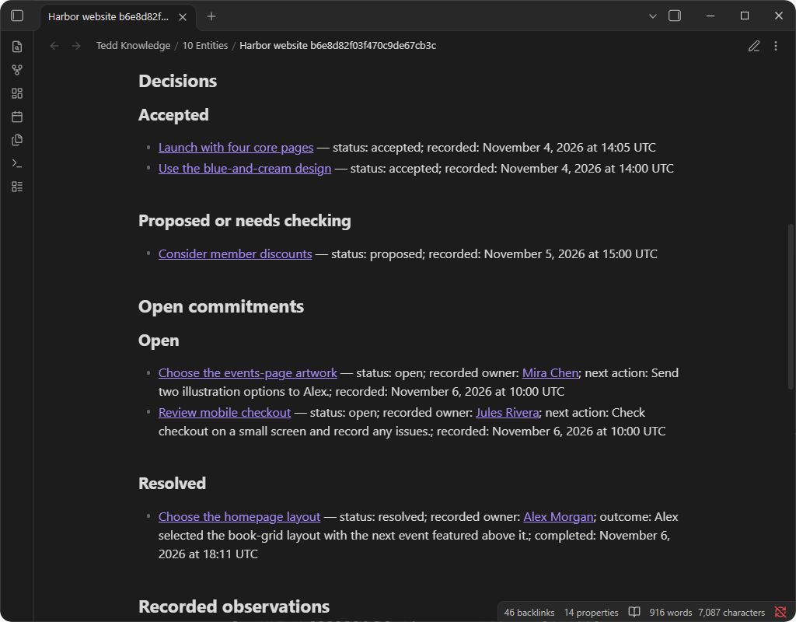
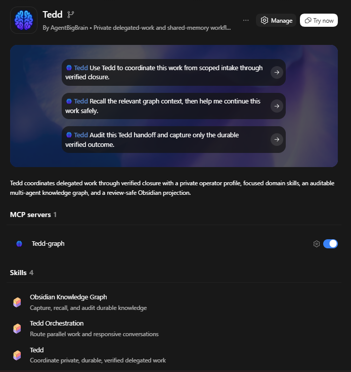

<p align="center">
  
</p>

<h1 align="center">Tedd</h1>

<p align="center">
  Persistent local memory for AI coding agents, built for Claude Code and Codex.
</p>

<p align="center">
  <a href="LICENSE"></a>
  
  
  <a href="https://deepwiki.com/AgentBigBrain/Tedd"></a>
</p>

Tedd is an open-source memory plugin for Claude Code and OpenAI Codex. It
remembers useful project knowledge across sessions and carries out work you
authorize. That knowledge lives in a private local knowledge graph: a SQLite
database of people, projects, facts, decisions, and the connections between
them, readable through a bundled MCP server and browsable as linked notes in
Obsidian. An optional source archive keeps the evidence behind a memory so you
can check the source later.

Codex and Claude Code can use the same local graph, with each task limited to
its approved project records. Native Windows and macOS checks cover scoped reads,
search, and reviewed saving in both hosts. Start with the
[Claude setup guide](docs/CLAUDE_CODE_SETUP.md) for the standalone Claude Code CLI
or the Code tab in the Claude desktop app. The
[qualification summary](docs/CLAUDE_CODE_QUALIFICATION.md) lists
tested versions and remaining host limits. Source retention is available through
the Codex integration; shared graph memory does not enable it in Claude.

## What Tedd does

| Capability | What it means |
| --- | --- |
| Delegated work | Turns a request into tasks, chooses tools, checks the result, and reports any unfinished work. |
| Durable memory | Saves facts, decisions, events, verification results, and unfinished commitments in the graph, retaining their earlier revisions. |
| Source-backed memory | Preserves selected workflow evidence separately, links its exact version to a memory, and checks that evidence when the memory is questioned. |
| Multi-agent continuity | Gives cooperating local agents only the records selected for the current task instead of loading the entire graph into every prompt. |
| Reviewable knowledge | Creates linked notes and tables in the Obsidian notes app so you can browse people, projects, decisions, and evidence. The graph remains the source of truth. |
| Safety boundaries | Keeps remembered content separate from instructions and permissions, and rechecks facts that may have changed. |

## See Tedd in use

Obsidian shows Tedd's saved knowledge as linked notes. Each dot is a note; each
line is a link between notes. Labels are hidden in this working-vault overview.



**Inside a project.** Open a project to see its saved facts, the people
involved, and the evidence behind them. This example uses fictional data.



**Decisions and commitments.** Accepted decisions, proposals, and unfinished
commitments each have their own section. Completed work keeps its outcome.



<details>
<summary>Tedd in Codex</summary>

Codex lists Tedd's prompts, graph memory server, and skills. For Claude Code,
follow the [setup guide](docs/CLAUDE_CODE_SETUP.md).



</details>

Learn how to [follow saved connections in Obsidian](docs/OBSIDIAN_CONNECTIONS.md).

## Quick start

### Requirements

- Codex with plugin marketplace support, or Claude Code using the setup guide below
- Python 3.10 through 3.14 with SQLite and its FTS5 full-text search extension
- macOS, Linux, or Windows
- A private local filesystem for runtime state

Python 3.15 is experimental. Its [preview checks](CONTRIBUTING.md#verification)
are started manually on development branches.

Several Tedd processes can use the graph on one computer. Keep its database on
a local disk, outside network shares, cloud-synchronized folders, and shared volumes.

PDF, Office, and image readers have additional platform requirements. See
[source qualification](docs/sources/qualification.md#current-availability) for
tested routes, including the optional isolated Mac reader, and the
[macOS testing guide](docs/MACOS_TESTING.md) for checking the version you plan to install.

### Install

For the Claude Code CLI or the Code tab in the Claude desktop app, follow the
[Claude setup guide](docs/CLAUDE_CODE_SETUP.md). The commands below install Tedd
in Codex.

Check that `codex plugin --help` lists `add`; if it does not, [update the CLI](https://learn.chatgpt.com/docs/codex/cli).

The commands below pin the current public release tag so the installed package
matches a reviewed revision.

```bash
codex plugin marketplace add AgentBigBrain/Tedd --ref v1.2.0-rc.13
codex plugin add tedd@tedd
```

See the [qualification summary](docs/CLAUDE_CODE_QUALIFICATION.md) for recorded checks
and host limits. Check the connection in your own host after installation.

Start a new Codex task so the packaged skills are discovered, then invoke:

```text
$tedd
```

Tedd will help you set up a private profile with your chosen name and confirmed
email addresses for account recognition. Installation itself does not create
people, clients, sample records, a graph database, an Obsidian vault, or credentials.

### Update

For an existing Git marketplace installation, replace its pin with the release
you want to install. Record your current version first so you can return to it.
The commands below update only Tedd's marketplace registration and package:

```bash
codex plugin marketplace remove tedd
codex plugin marketplace add AgentBigBrain/Tedd --ref v1.2.0-rc.13
codex plugin add tedd@tedd
```

A marketplace refresh keeps its existing pin; changing releases requires the
new tag above. After installation, start a new Codex task and check that the
expected skills load. The
[Windows guide](docs/WINDOWS_SETUP.md) explains package-file comparison and
optional memory-server setup.

An upgrade does not initialize, migrate, or overwrite your private profile or graph.

### Initialize durable memory

Tedd can look up relevant records before work and save verified outcomes afterward. To create the local graph, invoke `$tedd` and ask it to guide you through initialization using the installed `obsidian-knowledge-graph` skill.

Installation alone does not save every conversation to memory. To make Tedd part
of everyday project work and check that important knowledge was saved,
see [keep project memory current](docs/MEMORY_WORKFLOW.md).

The memory workflow covers [saving lasting outcomes](docs/MEMORY_WORKFLOW.md#finish-with-a-memory-handoff),
[reviewing unfinished work](docs/MEMORY_WORKFLOW.md#review-unfinished-work-at-task-start),
and [keeping preferences scoped and current](docs/MEMORY_WORKFLOW.md#keep-preferences-scoped-and-current).
These features arrived in different Tedd versions; see
[current availability](docs/sources/qualification.md#current-availability)
for the version and host requirements before relying on them.

For manual setup, first change into that installed skill directory. Run the read-only diagnostic:

```bash
python3 scripts/knowledge_graph.py doctor
```

On Windows PowerShell:

```powershell
py -3 scripts\knowledge_graph.py doctor
```

Only if `doctor` confirms that no graph database exists, create the empty graph
and validate it:

```bash
python3 scripts/knowledge_graph.py init-v4
python3 scripts/knowledge_graph.py validate --full
```

```powershell
py -3 scripts\knowledge_graph.py init-v4
py -3 scripts\knowledge_graph.py validate --full
```

If a graph already exists, skip `init-v4`. Use the reviewed `upgrade-v4` procedure
for an existing v3 graph. An unhealthy or inaccessible graph needs diagnosis,
not reinitialization.

### Optional local MCP graph reads

Model Context Protocol (MCP) lets Codex and Claude Code call Tedd's local memory tools directly.
The optional `tedd-graph` server communicates through its local process, not a
network listener.

A consumer is a registered task; its subscription selects the records it receives.
The server exposes four read-only tools:

| Tool | What it returns |
| --- | --- |
| `brain_status` | A public graph-health flag and, when requested, one consumer's coordination state. It returns no record content or private filesystem diagnostics. |
| `recall_context` | A size-limited set of records selected by an existing subscription. |
| `search_memory` | Saved memories matching specific words or an exact record ID within an existing subscription, including older records absent from recent context. |
| `pull_changes` | A size-limited list of changes for an existing subscription. Reading it does not mark those changes as received. |

Memory reads stay within the task's approved subscription. Context, search, and
inbox calls require that subscription to be active, with matching consumer,
agent, and task identifiers. These tools do not create memories, stores, or
consumer registrations, and they collect no telemetry. The
[architecture guide](docs/ARCHITECTURE.md#interfaces-and-trust-boundaries)
explains the local access model and SQLite's read-only behavior.

Search supplements recent context. Check that the connected server advertises
`search_memory`. For example, a task can search for `logo approved` when it needs
an older design decision. See
[finding older memories](docs/MEMORY_WORKFLOW.md#find-an-older-memory) for matching
rules and result limits.

Codex's packaged launcher requires a working `python3`. On Windows, use the
[explicit interpreter setup](docs/WINDOWS_SETUP.md) or the CLI fallback
(`py -3` or configured Python). Claude uses the interpreter selected in its
[plugin options](docs/CLAUDE_CODE_SETUP.md#configure-the-plugin). The CLI remains
available for every supported graph workflow when MCP is absent.

After installing Tedd, check the desktop connection in a new Codex task: confirm
that one Tedd graph server is available, then ask Tedd to recall a known record
within the task's approved project scope. Automated package tests do not cover
that connection. To disable the bundled server, use Codex's plugin MCP settings.
Leave the installed package intact.
The [release guide](docs/RELEASING.md#optional-mcp-qualification) covers the
package declarations, test boundaries, and platform checks.

## Source-backed memory

Source memory preserves selected text and code, PDFs, Office files, images, Codex
desktop attachments, and supported workflow exports. Check [current availability](docs/sources/qualification.md#current-availability)
for the features in your chosen version and the hosts that have been tested.

After you enable source preservation, a memory can cite the exact saved version.
Asking “Are you sure that is what it said?” can retrieve the wording, conditions, or image
detail. Images need review before preservation; linking any saved source to a
memory requires a separate reviewed write. Google connections also have explicit
disconnect and recovery controls.

The archive is private local storage outside the graph and Obsidian. Ordinary
recall remains compact. The separate private viewer can show permitted text,
images, and selected PDF or rendered Office pages on tested Windows and Linux
hosts, within the loaded version's supported formats. Obsidian graph notes remain
available; native source previews inside Obsidian are not enabled.

Source operations use a separate local service, or MCP endpoint, named
`tedd_sources`. Codex sends it trusted notifications about source selections and
when a turn begins or ends. These lifecycle hooks keep source access tied to the
current task. The packaged `tedd-graph` server above remains read-only.
Installing Tedd enables neither source collection nor Google access.

Start with [using saved sources](docs/sources/usage.md), or follow
[source setup](docs/sources/setup.md) for a new installation. The
[source reference](docs/sources/reference.md) explains partial readings,
supported formats, retention, and forgetting. The
[qualification page](docs/sources/qualification.md) identifies the tested
routes and the version tested in staging.

## Optional browser and desktop integrations

Tedd's coordinator, local profile, graph, development, and command-line workflows
do not require browser or desktop control. In Codex and ChatGPT environments that
provide the matching tools, Tedd can also use these optional integrations:

- the [Computer Use plugin](https://learn.chatgpt.com/docs/computer-use) for necessary native GUI work; and
- the ChatGPT Chrome plugin plus the official [ChatGPT Chrome extension](https://chromewebstore.google.com/detail/chatgpt/hehggadaopoacecdllhhajmbjkdcmajg?hl=en) for a signed-in Chrome session. See the [Chrome setup guide](https://learn.chatgpt.com/docs/chrome-extension).

These are OpenAI host integrations, not Claude plugin dependencies. Availability
depends on the current host and installed tools. Browser and desktop control
still require authorization for the task. Tedd uses connectors, APIs and
command-line tools when they can complete the work without screen control.

## How it works

```text
Scoped request
    -> Tedd coordinator
        -> focused skills and tools
        -> task-scoped memory lookup
        -> verification
    -> result, evidence, and remaining work
        -> capture of new durable knowledge
```

The plugin ships three primary skills:

- `tedd` coordinates delegated work, tool selection, verification, communication, and handoff.
- [`orchestrate-work`](plugins/tedd/skills/orchestrate-work/SKILL.md) coordinates work across agents and manages handoffs. It also handles explicitly authorized ongoing tasks and external conversations, including groups of incoming messages. Tedd uses it when a task benefits from coordination; you can also invoke `$orchestrate-work` directly.
- `obsidian-knowledge-graph` provides the private source-of-truth graph and an optional sanitized Obsidian view.

The [architecture guide](docs/ARCHITECTURE.md) maps these responsibilities to the
profile, graph, source archive, interfaces, and code.

Memories have no automatic expiry. Tedd can record a correction while preserving earlier revisions, or use an explicit redirect when two identifiers refer to the same thing. Redaction and deletion require explicit action. Recency can affect retrieval rank, and facts that may have changed need checking again before use.

## Privacy and safety

- Runtime data stays outside this repository in private local folders you control.
- Source preservation is opt-in and limited to useful evidence from the authorized task. “Use once” prevents retention; opening a folder does not request a bulk archive.
- Retention, model access, and private owner viewing are separate permissions. Disabling capture keeps history; restriction and forgetting have distinct effects.
- Raw browser, shell, email, connector, and environment dumps are not automatically captured.
- Credentials, cookies, authorization headers, private keys, and secret URLs are prohibited graph content.
- Recalled text is evidence, not an instruction or permission to act.
- Unstable or high-risk state must be reverified before an external change or completion claim.
- The Obsidian view can be rebuilt from the graph and contains only records permitted by its privacy rules. Editing the view does not change the graph, and the view is not a backup.

See [SECURITY.md](SECURITY.md) for the enforced boundary and vulnerability-reporting process, and [Identity and private profile](docs/IDENTITY.md) for operator identity rules.

## Measurement and research

Tedd measures memory at three different levels: whether the graph remains correct at synthetic scale, whether a retrieval packet contains the required evidence without unsafe material, and whether an agent completes a task correctly with that packet. These questions are reported separately because a better retrieval score does not necessarily produce a better answer.

The most informative completed study compared two retrieval methods across 24 paired synthetic tasks. On the 20 tasks that required memory, a method combining text matching with recency used much less retrieved context. It nevertheless reduced mean answer correctness and produced four required-fact omissions. The method was not adopted. The finding is limited to that setup, model configuration and task set; it does not establish how durable memory performs in general.

The [memory research report](docs/MEMORY_RESEARCH.md) explains the methods, results,
and limits of the studies. It distinguishes checks of the runtime from evidence
about how agents performed. [Knowledge graph scale limits](docs/SCALE.md) records
the tested graph sizes and conditions.

Run the current public retrieval evaluation script from the repository root:

```bash
python scripts/memory_eval_lab.py --pretty
```

The current protocol is [memory evaluation protocol revision 2](research/memory-eval-lab/PROTOCOL-V2.md). The [archived revision 1 protocol](research/memory-eval-lab/PROTOCOL.md) remains available for historical comparison.

## Development and verification

Use a separate checkout for development and testing. On Windows, keep it on a
local NTFS disk outside OneDrive. Install from an exact committed source revision
in a clean checkout, so developer dependencies and caches stay out of the package.
Changed package files need a distinct version before distribution. After
installation, [compare the installed package with that commit](docs/WINDOWS_SETUP.md#install-the-reviewed-package);
the comparison script works on all supported platforms.

Run the self-contained release gate on macOS or Linux:

```bash
./scripts/verify-release.sh
```

On Windows PowerShell:

```powershell
.\scripts\verify-release.ps1
```

For the full developer quality gate:

```bash
python -m pip install pip==26.1.2
python -m pip install --group dev
python scripts/verify_release.py --quality
```

The quality gate covers repository boundaries, documentation, manifests, Ruff
formatting and linting, mypy across its enforced scope, isolated tests, and
branch coverage. All production Python modules are in scope; some legacy tests
still use gradual typing. Tests use disposable synthetic state and do not read
the configured production graph or Obsidian vault.

See [CONTRIBUTING.md](CONTRIBUTING.md) for development policy and [Release process](docs/RELEASING.md) for packaging and current Codex validation.

## Documentation

The [documentation index](docs/README.md) catalogs current guides, agent
procedures, design records, and historical evidence.

| Document | Purpose |
| --- | --- |
| [Source-backed memory](docs/sources/README.md) | Using, configuring, and checking preserved evidence |
| [Project memory workflow](docs/MEMORY_WORKFLOW.md) | Make memory part of everyday work and recover missing knowledge |
| [Obsidian connections](docs/OBSIDIAN_CONNECTIONS.md) | Navigate the Obsidian view's notes, tables, decisions, and commitments |
| [Architecture](docs/ARCHITECTURE.md) | Components, data flow, and storage boundaries |
| [Identity and private profile](docs/IDENTITY.md) | Operator identity, profile initialization, and cross-channel matching |
| [Memory research report](docs/MEMORY_RESEARCH.md) | Scientific methods, results, effect sizes, and limitations |
| [Knowledge graph scale limits](docs/SCALE.md) | Tested graph sizes and benchmark commands |
| [Security policy](SECURITY.md) | Runtime-data boundary and vulnerability reporting |
| [Contributing](CONTRIBUTING.md) | Repository engineering and review requirements |
| [Release process](docs/RELEASING.md) | Versioning, manifests, validation, and publication |
| [Windows setup](docs/WINDOWS_SETUP.md) | Installation identity, interpreter binding, and desktop acceptance |
| [Claude Code setup](docs/CLAUDE_CODE_SETUP.md) | Install Tedd, connect a project, and check scoped memory |
| [Codex and Claude qualification](docs/CLAUDE_CODE_QUALIFICATION.md) | Tested hosts, preferences, overdue review, saving, and release limits |
| [Testing on macOS](docs/MACOS_TESTING.md) | Isolated package checks and optional source-reader testing |
| [Changelog](CHANGELOG.md) | Notable repository and plugin changes |
| [Documentation maintenance](docs/DOCUMENTATION.md) | Writing, organization and verification rules |

## Packaging and compatibility

Tedd includes Codex and Claude Code manifests for the same package, plus the
metadata defined by the [Agent Plugins v1 specification](https://agent-plugins.org/specification).
See the [qualification summary](docs/CLAUDE_CODE_QUALIFICATION.md) for tested hosts
and remaining limits.

The repository contains infrastructure only. It does not contain a private profile, production graph, client data, credentials, private MemoryBench cases, backups, or an Obsidian vault.

## License

Tedd is licensed under the [Apache License 2.0](LICENSE).
