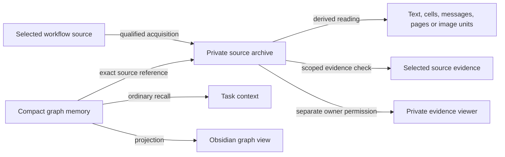

# Tedd architecture

Tedd combines agent instructions with private local storage. Its coordinator
follows the packaged skills to carry out a task. The operator profile identifies
the user and their confirmed accounts. The knowledge graph stores people,
projects, facts and their relationships in a database. An optional source archive
keeps the evidence behind those memories separately.

Skills guide the agent's choices. Python commands enforce storage, access scope,
validation and the checks required before saving a change or source.

## Responsibilities

| Component | Owns |
| --- | --- |
| Tedd coordinator | Task scope, tool choice, communication and verified completion |
| Operator profile | Explicitly confirmed identity and account aliases |
| Canonical graph | The authoritative database: entities such as people and projects, claims about them, decisions, events, verification receipts and commitment history |
| Source archive | Immutable acquired bytes, derived readings, exact versions and exclusions |
| Source host | Trusted task inputs, provider access, cancellation and approved readers/viewers |
| Obsidian projector | Generates permitted graph records as linked notes and tables in Obsidian; this copy is called a projection |
| Private evidence viewer | A separate human display for permitted source text and images |

The profile, graph, source archive and projected vault have separate purposes and
storage boundaries. Installing the plugin initializes none of them.
[Identity](IDENTITY.md), [source setup](sources/setup.md) and the
[graph skill](../plugins/tedd/skills/obsidian-knowledge-graph/SKILL.md) describe their setup.

## Memory and evidence

The graph uses SQLite with a write-ahead log (WAL) and revision history. It records
current claims and their history, exact evidence links, and coordination state
for local agents.
A registered task is a *consumer*. Its subscription selects the records it can
receive; a global search is not a replacement for an authorized scope.
Ordinary updates preserve earlier revisions; privacy redaction can remove earlier
payload bodies while retaining their audit history.

The source archive stores originals and a metadata file, called a manifest, for
each saved version. The manifest records its identity, access scope, file hashes
and reading coverage: which parts were read and which were not. A source
reference identifies an exact manifest and unit, such as a message or page.
A later capture creates another version; it does not rewrite the
version behind an earlier memory.

The archive saves a source before Tedd links a graph memory to it. The source
therefore remains available if the memory write fails. Checking a disputed memory
reads the saved evidence; correcting that memory requires a separate reviewed write.
Ordinary recall continues to return compact graph context.

A reading copy can be partial. Extracted text, an embedded-image frame, a
standalone-image view and a rendered Office page have different limits.
[Source reference](sources/reference.md) defines those distinctions.

Each standalone image has an inventory of its frames, pages, items and variants.
The reader applies orientation and produces metadata-free PNG overviews
or detail views. The exact original retains its permitted metadata. Review
receipts bind delivered pixels to the original bytes, task, audience and viewed
area. Every required view must be acknowledged before preservation. Human review
uses the private viewer; model review uses the image returned by the source tool.
Neither acknowledgment creates a graph memory. Review receipts live only for the
active turn, so changed bytes or a later turn require fresh review before saving.

## Interfaces and trust boundaries

Tedd's MCP endpoints are local services whose tools Codex calls through Model
Context Protocol. The `tedd-graph` endpoint exposes four read tools: graph health
(`brain_status`), recent subscription context (`recall_context`), memory search
(`search_memory`) and the change inbox (`pull_changes`).
The graph endpoint does not initialize a graph, collect sources or write memories.
The separately configured `tedd_sources` endpoint supports acquisition,
evidence checks, reviewed memory
binding and private viewing. Trusted lifecycle hooks notify it of source
selections and when each turn begins or ends. It also needs a fixed graph
configuration; the graph endpoint's read-only description does not apply to it.

Graph subscription and session identifiers keep one operator's local agents from
mixing scopes. They are not passwords or an authentication boundary between users.
They do not provide an operating-system sandbox.
Graph MCP reads make no durable graph, configuration or SQLite write-ahead-log
changes. SQLite may still update an existing `-shm` coordination file during a read.

Memory search supplements recent context using the existing current-record
full-text index. It checks the active subscription and its consumer, agent and
task in the same database snapshot as the results. Search reuses the subscription's
selection rules: a record can match any included criterion, so an intentionally
broad subscription stays broad. Out-of-scope, sensitive, redacted, tombstoned and
missing-payload records cannot occupy the result limit, even through an exact ID.
Eligible matches are ordered by exact ID first, then most recent record update
and stable ID. Records outside the scope do not influence that ordering.
Output is sanitized before the result-list character limit is applied. Search
adds no migration, dependency, source-byte access or change to global CLI search.

Source publication rechecks current scope, local permission, workflow state and
integrity. Provider-checked Google sources also require current provider access.
Owner-confirmed browser exports carry a different retained-copy policy: their
historical use does not independently verify Google's current permission or revision.

Google connection controls keep local access, credential removal
and provider revocation separate. Confirmed disconnect disables the connection
before attempting revocation. A connection generation and operation identity
prevent in-flight work or an old request from publishing against a disabled or
replacement grant. Recovery waits for the earlier local sender to stop and
requires a separate warning and fresh consent; it cannot prove that a delayed
provider revocation will spare the new grant. Archive bytes remain intact, while
provider-checked Google reads stay unavailable until current access is restored.
These controls do not change permissions for ordinary local evidence.

On macOS, supported PDF, Office and image operations run in a Linux ARM64 virtual
machine approved through a private enrollment file. Their native workers remain
disabled. Plain UTF-8 text, Markdown and code use the direct text reader. The source host chooses either an already
running isolated reader or a separately authorized cold-start reader. Both bind
the exact tools, image and private runtime state, and recheck them within the
operation's deadline. The cold path can start the dedicated provisioned VM; neither path
downloads or rebuilds it. Reader containers have networking disabled. This
boundary is separate from the private owner viewer and Google sign-in. See
[reader setup](sources/setup.md#optional-isolated-mac-reader) for configuration.

The archive is private local storage outside Git, the graph, the vault, cloud sync
and network shares. Source text is evidence; it cannot enroll another path, grant
permission or change a task. Sensitive owner-only viewing does not grant model
access. [Security](../SECURITY.md) describes these boundaries.

The projector writes a bounded, sanitized graph view. Editing generated notes
does not update the graph. Native Obsidian source previews have their own
qualification gate and are currently disabled; private-viewer qualification does
not enable them.

During one projection, the renderer builds an in-memory map from eligible record
IDs to generated paths and a reverse index from entities to their selected
records. It uses those indexes to create ordinary observation notes, explicit
record-to-record links, relationship explanations, and grouped person/project
summaries. The indexes are discarded after rendering; they are not another graph
store and they do not change recall or canonical records. The same display
eligibility check applies to a link, its endpoints, reverse references, owners,
and table rows so hidden records cannot reappear through navigation.

The dashboard reports the canonical snapshot revision and whether the selected
view is complete or bounded when that metadata is available. Legacy payloads say
that selection was not reported rather than inventing completeness. See
[Follow Tedd's saved connections in Obsidian](OBSIDIAN_CONNECTIONS.md) for the
reader workflow and its limits.

## Code map

| Path | Responsibility |
| --- | --- |
| `plugins/tedd/skills/tedd/` | Coordinator instructions, profile CLI and workflow references |
| `plugins/tedd/skills/orchestrate-work/` | Handoff and coordination procedures |
| `plugins/tedd/skills/obsidian-knowledge-graph/scripts/knowledge_graph.py` | Public graph CLI |
| `plugins/tedd/skills/obsidian-knowledge-graph/scripts/tedd_graph_mcp.py` | Packaged read-only graph endpoint |
| `plugins/tedd/skills/obsidian-knowledge-graph/scripts/tedd_sources.py` | Source CLI, publication and maintenance orchestration |
| `plugins/tedd/skills/obsidian-knowledge-graph/scripts/tedd_sources_mcp.py` | Source MCP transport and host configuration |
| `plugins/tedd/skills/obsidian-knowledge-graph/scripts/tedd_knowledge_graph/` | Graph services, archive contracts, readers, provider and viewer implementations |
| `tests/` | Repository-only tests and synthetic support fixtures |
| `scripts/` | Repository validation, release verification and public evaluation tools |
| `.agents/skills/python-development/` | Contributor Python guidance; not shipped in the plugin |

Several local processes can share one graph on one computer. Concurrent writers
on another computer require an authenticated service, not a shared SQLite file.
The [scale guide](SCALE.md) reports graph capacity measurements. Checks for excluded
sources have a separate [archive-growth limit](sources/reference.md#limits).
